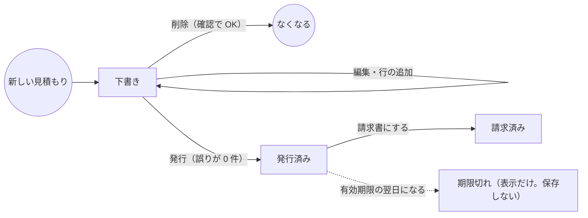

# テスト設計

- テストの根拠：[仕様書](spec.md)。表のすべての行に、根拠になる仕様の項目 ID（`S-...`）を書く。
- 方針：[テスト計画](test-plan.md)
- 作成日：2026-11-21（アプリを作り始める前に、仕様書だけから設計した）
- 下書き：Claude Code（AI）。試す値の選び方は、オーナーが決めた（下の「方針の決定」）。
- この設計をもとに、テストケース一覧（`tests/cases.csv`）を作る。ケース一覧の「技法」の列には、1 章の 6 つの名前を使う。

記号：○ = 受け付ける・できる、✕ = 誤りになる・できない。

## 方針の決定（2026-11-21）

Claude Code が選択肢と推奨案を示し、オーナーが選んで決めた。

1. 境界値は、境目ごとに 2 つ（範囲の端と、そのすぐ外側）を試す。例：数量は 0・1・9,999・10,000（2.1）。理由：整数の範囲チェックの誤りは、ほとんどが端の扱いの書き間違い（`<` と `<=` の取り違えなど）で、端とそのすぐ外側の 2 点で見つかる。ケースを増やしすぎずに、見つけるべき誤りは落とさない。
2. 「発行できるか」のデシジョンテーブルは、8 つの組み合わせのうち意味のある 5 つに絞る（すべて正しい 1 つ、条件を 1 つずつ崩す 3 つ、誤りが 2 つ重なる 1 つ）（3.1）。理由：1 つでも誤りがあれば押せない決まりなので、崩す条件を増やしても、押せるかどうかの結果は同じ。誤りの件数の数え方を見る 1 つだけを残し、画面の操作では作れない組み合わせも外した。

何を自動にして何を手で確かめるかの決定は、[テスト計画](test-plan.md)に書いた。

## 1. 使う技法

| 技法 | 何をするか | 主に使うところ | 主な仕様 |
|---|---|---|---|
| 同値分割 | 入力を「同じ扱いになるグループ」に分け、グループごとに代表の値を試す | 数値の読み取り、文字の数え方、URL、一覧、保存の状態、環境 | S-INP-11, S-INP-13, S-SCR-09, S-STO-03 |
| 境界値分析 | グループの境目を試す。誤りは境目で起きやすい | 数量、単価、値引き額、文字数、行数、値引きの上限、番号の桁、金額の表示 | S-INP-03〜S-INP-09, S-NUM-06 |
| デシジョンテーブル | 条件の組み合わせと結果を表にして、組み合わせの漏れを防ぐ | 発行できるか、誤りの件数と文言、請求書にできるか | S-INP-17, S-INP-33, S-ST-04〜S-ST-07 |
| 状態遷移 | 状態と操作のすべての組み合わせを表にし、できる操作に加えて、できない操作が本当にできないことも確かめる | 下書き・発行済み・期限切れ・請求済み | S-ST-01〜S-ST-17 |
| 日付境界 | 境界値分析を日付に当てはめる。月末、2 月、うるう年、年またぎ、期限の当日と翌日、日本時間の 0 時の前後を試す | 有効期限、支払期限、期限切れ、「今日」 | S-DATE-01〜S-DATE-10 |
| 計算の比較 | 正しい計算と、ありがちな誤った計算とで答えが変わる入力を、わざと選ぶ（一般にいう「エラー推測」に近い） | 税額の端数処理、値引き、税抜の入力、大きな金額 | S-CALC-01〜S-CALC-08 |

## 2. 同値分割・境界値分析

### 2.1 範囲の境界値

範囲の両端と、そのすぐ外側の値を試す（境目の両側で 2 つずつ。方針の決定 1）。範囲チェックのよくある誤り（`<` と `<=` の取り違えなど）は、この値で見つかる。

| 項目 | 仕様の範囲 | 試す値 | 仕様 | 選んだ理由 |
|---|---|---|---|---|
| 数量 | 1〜9,999 の整数 | 0 ✕、1 ○、9,999 ○、10,000 ✕ | S-INP-05, S-INP-21 | 範囲の両端とそのすぐ外側。ほかの数値の項目も同じ考え方で選ぶ |
| 単価 | 0〜9,999,999 円 | -1 ✕、0 ○、9,999,999 ○、10,000,000 ✕ | S-INP-06, S-INP-12, S-INP-22 | 下限が 0（0 円の行を許す）で、ほかの数値の項目と下限が違う。-1 は範囲を比べる前に、マイナス記号があるため読み取りで誤りになる（S-INP-12） |
| 値引き額 | 1〜9,999,999 円 | 0 ✕、1 ○、9,999,999 ○、10,000,000 ✕ | S-INP-08, S-INP-23 | 上限は単価と同じで、下限だけが違う（0 は誤り）。単価の決まりを使い回す誤りを見つける |
| 宛先 | 1〜50 文字（必須） | 0（空）✕、1 ○、50 ○、51 ✕ | S-INP-01, S-INP-15, S-INP-16 | 必須の文字の項目の代表 |
| 件名 | 0〜50 文字（任意） | 0（空）○、50 ○、51 ✕ | S-INP-02, S-INP-18 | 任意なので空は誤りでない。宛先と同じ扱いにしてしまう誤りを見つける |
| 品名 | 1〜40 文字（必須） | 0（空）✕、1 ○、40 ○、41 ✕ | S-INP-04, S-INP-19, S-INP-20 | 上限が 40 で、ほかの文字の項目（50）と違う |
| 明細の行数 | 1〜20 行 | 0 ✕、1 ○、20 ○、21 ✕ | S-INP-03, S-INP-24, S-INP-25, S-INP-36, S-INP-37 | 0 行は最後の 1 行を削除して作る。21 行は画面の操作では作れないので、保存データで用意する |
| 追加のボタン（「明細を追加」「値引きを追加」） | 20 行で押せなくなる | 19 行で押せる、20 行で押せない | S-INP-29 | ボタンの境目は 19 と 20 で、入力チェックの境目（20 と 21）と 1 つずれる |
| 値引き行を含めた行数 | 値引き行も 1 行と数える | 明細 19 行＋値引き 1 行で、追加のボタンが押せない。明細 20 行＋値引き 1 行（保存データ）は ✕ | S-INP-03, S-INP-25, S-INP-29 | 値引き行を数え忘れる誤りを見つける |
| 番号の桁 | `Q-0001` から順に。9999 を超えると桁が増える | 最初は `Q-0001`・`INV-0001`。9,999 番目は `Q-9999`、10,000 番目は `Q-10000`（`INV` も同じ） | S-NUM-01, S-NUM-03, S-NUM-06 | 4 桁の 0 埋めが終わり、桁が増える境目。9,999 番目までは保存データで用意する |

### 2.2 数値の読み取り

数量・単価・値引き額の 3 つすべてで試す。決まり（S-INP-11）は 3 つに共通だが、作りが項目ごとに分かれていても見逃さないため。読み取った値が範囲に入るかは、2.1 で確かめる。

| グループ | 入力の例 | 読み取った値 | 仕様 | 選んだ理由 |
|---|---|---|---|---|
| 半角の数字 | `12` | 12 | S-INP-11 | 基本の形 |
| 全角の数字 | `１２` | 12 | S-INP-11, S-INP-32 | iPhone の日本語入力で入りやすい |
| カンマ | `1,000` | 1000 | S-INP-11, S-INP-32 | 金額でよく書く形 |
| 全角のカンマ | `１，０００` | 1000 | S-INP-32 | 全角を半角にそろえてから、カンマを取り除く順番を確かめる |
| 前後の空白 | ` 5 `、`　5　`（全角の空白） | 5 | S-INP-32, S-INP-38 | 貼り付けたときに入りやすい |
| 先頭の 0 | `007` | 7 | S-INP-32 | 先頭の 0 を誤りにしたり、別の数として読んだりしないか |
| 続いたカンマ | `1,,0` | 10 | S-INP-32 | カンマの位置を問わないこと（仕様の例） |
| 中の空白 | `1 000` | ✕ | S-INP-11, S-INP-12 | 取り除くのは前後の空白だけ。すべての空白を取り除いてしまう誤りを見つける |
| 小数 | `1.5` | ✕ | S-INP-12 | 整数でないもの |
| マイナス | `-1` | ✕ | S-INP-12 | 符号の付いたもの |
| プラス記号 | `+5` | ✕ | S-INP-12 | 数に変える仕組みの多くは `+5` を 5 と読んでしまう |
| 指数表記 | `1e3` | ✕ | S-INP-12 | 同じく 1000 と読まれやすい |
| 空 | （何も入れない） | ✕ | S-INP-12 | 入力がないもの |
| 空白だけ | `   ` | ✕ | S-INP-12 | 前後の空白を取り除くと空になるもの |
| 数字以外の文字 | `100円` | ✕ | S-INP-12 | 金額の欄に「円」まで打つのは、ありがちな入力 |

### 2.3 文字の数え方

宛先・件名・品名は同じ数え方（S-INP-13、S-INP-14、S-INP-38）なので、宛先を代表にして試す。2.2 の数値は 3 つすべてで試したが、ここは絞った。数値の読み取りを誤るとお金の計算がずれるが、文字の数え方を誤っても、影響は入力チェックにとどまるため（リスクに合わせて数を決めた）。ただし上限の違う品名では、数え方を誤りやすい `𠮷` を 40 個 / 41 個でも試す。

| 入力 | 数える文字数 | 期待 | 仕様 | 選んだ理由 |
|---|---|---|---|---|
| 前後に半角の空白を付けた 50 文字 | 50 | ○ | S-INP-13 | 空白を取り除く前に数えると 51 文字以上になり、誤りにしてしまう |
| 前後に全角の空白（`　`）を付けた 50 文字 | 50 | ○ | S-INP-13, S-INP-38 | 日本語の入力でよく入る空白。半角の空白だけを取り除く誤りを見つける（7 章で決まった点） |
| 半角の空白だけ | 0（空） | ✕「宛先を入力してください」 | S-INP-13, S-INP-15 | 空白だけを「入力あり」と見なす誤りを見つける |
| 全角の空白だけ | 0（空） | ✕「宛先を入力してください」 | S-INP-15, S-INP-38 | 上の行と同じ誤りを、全角の空白でも見つける（7 章で決まった点） |
| `𠮷` を 50 個 / 51 個 | 50 / 51 | ○ / ✕ | S-INP-14 | 人名で使う文字で、プログラムの中では 1 文字が 2 つ分の長さになる |
| `👨‍👩‍👧` を 50 個 / 51 個 | 50 / 51 | ○ / ✕ | S-INP-14 | 仕様の例。いくつかの文字を組み合わせて 1 文字に見せる絵文字 |
| 品名に `𠮷` を 40 個 / 41 個 | 40 / 41 | ○ / ✕「品名は40文字以内にしてください」 | S-INP-14, S-INP-20 | 上限の違う項目でも、同じ数え方になっているか |

### 2.4 値引きの上限

| 明細 | 値引き | 期待 | 仕様 | 選んだ理由 |
|---|---|---|---|---|
| 10% の明細の合計 1,000 円 | 10% の値引き 1,000 円 | ○（10% の対象額 0 円、税額 0 円） | S-INP-09, S-CALC-05 | 同額は許される。境目そのもの |
| 10% の明細の合計 1,000 円 | 10% の値引き 1,001 円 | ✕「10%の値引きが、10%の明細の合計を超えています」 | S-INP-09, S-INP-26 | 境目のすぐ外側 |
| 10% の明細の合計 1,000 円だけ（8% の明細はない） | 8% の値引き 1 円 | ✕「8%の値引きが、8%の明細の合計を超えています」 | S-INP-09, S-INP-26 | 同じ税率の明細がないときは 0 円として扱う。全体の合計で比べてしまう誤り（全体では超えていない）も見つける |
| 10% の明細 1 行で、単価が空（ほかは正しい） | 10% の値引き 1 円 | ✕（値引きの超過と、単価の誤り） | S-INP-09, S-CALC-11 | 空の単価を 0 円として数えるか |

### 2.5 画面の URL

| 開く URL | 期待 | 仕様 | 選んだ理由 |
|---|---|---|---|
| `#/` | 見積もり一覧 | S-SCR-01 | 決まった画面のグループ |
| `#/quotes/<ある ID>` | 見積もり画面 | S-SCR-01 | 同上 |
| `#/invoices/<ある ID>` | 請求書画面 | S-SCR-01, S-SCR-08 | 同上 |
| `#/tests` | テスト資料の画面 | S-SCR-01, S-SCR-12 | 同上 |
| `#/quotes/xxx`、`#/invoices/xxx` | 「見つかりません」と「一覧に戻る」リンク | S-SCR-09, S-DISP-17 | 形は正しいが、ID が存在しないグループ |
| `#/foo` | 「見つかりません」と「一覧に戻る」リンク | S-SCR-09 | 決まっていない hash のグループ |
| hash のない URL（例：`/`） | 見積もり一覧（`#/` と同じ） | S-SCR-19 | 公開 URL をそのまま開いたとき。面接官が最初に見る画面（7 章で決まった点） |
| 上の画面すべてと「見つかりません」の画面 | 注意書き「ポートフォリオ用の練習アプリです。実際の取引には使えません。」と、ヘッダーの「テスト資料」リンクがある | S-SCR-10, S-SCR-12 | 画面の種類ごとに確かめる。どれか 1 つで出し忘れるのを見つける |

### 2.6 一覧

| 一覧の中身 | 期待 | 仕様 | 選んだ理由 |
|---|---|---|---|
| 0 件 | 「見積もりはまだありません」 | S-SCR-03, S-DISP-14 | 初めて開いたときに必ず見る状態 |
| 下書き 1 件 | 1 行。見積もり番号・発行日・有効期限は「—」。合計（税込）は下書きの計算結果 | S-SCR-02, S-SCR-15, S-NUM-02, S-CALC-12 | 値のないセルの扱いと、途中の下書きの合計 |
| 3 件を順に作る | 最後に作ったものが一番上 | S-SCR-14 | 2 件だと、ほかの並べ方でもたまたま合うことがあるため 3 件にする |
| 状態の違う見積もりがある | 状態の列に、下書き / 発行済み / 期限切れ / 請求済み | S-SCR-02, S-ST-03 | 期限切れは保存しない状態なので、一覧でも正しく出るか |

### 2.7 表示の形

| 確かめること | 値 | 期待 | 仕様 | 選んだ理由 |
|---|---|---|---|---|
| 金額 | 0、999、1,000、999,999、1,000,000、2,199,779,780,022 | `0円`、`999円`、`1,000円`、`999,999円`、`1,000,000円`、`2,199,779,780,022円` | S-DISP-01 | カンマが付き始める境目（999 と 1,000）、カンマが 2 つになる境目（999,999 と 1,000,000）、一番大きい合計（S-CALC-08） |
| 値引き行 | 値引き額 1,000 円 | ラベル「値引き」、金額 `-1,000円`。見積もり画面と請求書画面の両方 | S-DISP-07, S-DISP-08 | マイナス記号とカンマが同時に付く形。2 つの画面の作りが別でも見逃さない |
| 日付 | 2026-11-21、2027-01-01 | `2026/11/21`、`2027/01/01` | S-DISP-02, S-DISP-19 | 仕様の例と、月・日がどちらも 1 桁の日付。0 を付け忘れる誤りを見つける（7 章で決まった点） |
| マイナスの金額 | 対象額 -50 円（5 章の、値引きが超過している下書き） | 対象額 `-50円`、税額 `0円`、合計 `-50円` | S-DISP-20, S-CALC-05 | 値引き行と同じ半角のマイナスか。全角のマイナスや「▲」にしてしまう誤りを見つける（7 章で決まった点） |
| 計算結果の欄 | 10% の明細だけ | 8% の欄（`base-8`、`tax-8`）に `0円` | S-CALC-10, S-DISP-03 | 明細のない税率の欄を消してしまう誤りを見つける |
| 新しい下書き | 何も入れない | 計算結果がすべて `0円`。一覧の合計も `0円` | S-CALC-12, S-SCR-05 | 入力の途中でも計算結果を出す。空の値で計算が止まる誤りを見つける |

### 2.8 保存の状態

| 保存の状態 | 期待 | 仕様 | 選んだ理由 |
|---|---|---|---|
| 保存データがない（初めて開く） | 空の一覧。【削る候補】「見本を入れる」ボタン | S-SCR-03, S-STO-06 | 面接官が最初に見る状態 |
| 保存できる | 入力のたびに自動で保存される（保存ボタンはない）。誤りのある途中の下書きも、読み込み直したあとに残る | S-STO-01, S-STO-02, S-INP-27 | 基本の動き。誤りがあると保存しない誤りも見つける |
| 保存できない（書き込みが失敗する） | 画面は止まらない。入力した内容は画面に残る。「保存できませんでした。」の帯（`role="alert"`）を出し続ける | S-STO-03, S-STO-04, S-STO-05, S-DISP-16 | 実機では起こしにくいので、自動テストでわざと失敗させる |
| 保存データが壊れている（読めない形） | 「保存データを読み込めませんでした。」。【削る候補】「データを消して初めからやり直す」で空の一覧になり、次に発行する見積もりは `Q-0001` | S-STO-07, S-STO-08, S-STO-09, S-DISP-15 | 壊れたデータで画面が止まる不具合はよくある |
| 【削る候補】「見本を入れる」を押す | ちょうど 3 件（下書き、今日発行した発行済み、今日請求した請求済み）。宛先はすべて「（架空）」で終わる。10% の明細、8% の明細、値引き行を含む | S-STO-06, S-STO-10, S-STO-11, S-STO-12 | 面接官が最初に触るデータなので、中身まで確かめる |

【削る候補】の機能を作らなかった場合は、その行をこの表から外す。

### 2.9 環境

| 環境のグループ | 代表 | 確かめること | 仕様 | 選んだ理由 |
|---|---|---|---|---|
| PC の広い画面 | Chromium（デスクトップ） | すべての画面の表示と操作 | S-SCR-11 | PC で使う人の代表 |
| iPhone の狭い画面 | 375px 幅の画面と、WebKit の iPhone 15 相当 | ページ全体が横にスクロールしない。明細の表は枠の中で横にスクロールしてよい | S-SCR-11 | 仕様の幅。iPhone 15 相当は 393px 幅なので、375px は別に試す |
| iPhone 実機 | Safari と、ホーム画面アプリ | 見た目と操作感（手動） | S-DISP-06, S-SCR-11 | 良し悪しを機械では決めにくい |

## 3. デシジョンテーブル

### 3.1 発行できるか

「発行」は下書きでだけ表示する（4 章）。下書きでは、次の 3 つの条件がすべて満たされたときだけ押せる。Y = 満たす、N = 満たさない。

| | 仕様 | R1 | R2 | R3 | R4 | R5 | R6 | R7 | R8 |
|---|---|---|---|---|---|---|---|---|---|
| 条件 1：項目の入力に誤りがない | S-INP-01, S-INP-02, S-INP-04〜S-INP-08 | Y | N | Y | Y | N | N | Y | N |
| 条件 2：明細が 1〜20 行 | S-INP-03 | Y | Y | N | Y | N | Y | N | N |
| 条件 3：値引きが超過していない | S-INP-09 | Y | Y | Y | N | Y | N | N | N |
| 結果：「発行」を押せる | S-INP-17, S-ST-08 | ○ | ✕ | ✕ | ✕ | ✕ | ✕ | ✕ | ✕ |
| 結果：灰色の「発行」と「入力の誤りが N 件あります」 | S-ST-14, S-INP-31 | — | ○ | ○ | ○ | ○ | ○ | ○ | ○ |
| 画面の操作で作れるか | S-INP-36, S-INP-37 | ○ | ○ | ○（0 行） | ○ | ○（0 行） | ○ | 保存データだけ（21 行） | 保存データだけ（21 行） |

「押せるか」を確かめるルール：R1、R2、R3、R4、R6 の 5 つ（8 つのうち、意味のある組み合わせに絞る。方針の決定 2）。

- R1：押せる、ただ 1 つの組み合わせ。
- R2・R3・R4：条件を 1 つずつ崩す。どの条件も、それだけで「押せない」になることを確かめる。1 つの条件だけを変えて、その条件が結果を左右することを確かめるのは、MC/DC（改良条件判定カバレッジ）と同じ考え方。
- R6：誤りが 2 種類重なったとき、件数 N が両方を数えること（3.2）を、画面の操作で確かめられる組み合わせ。
- R5：「押せるか」はここでは試さない。この組み合わせ（宛先が空で、明細 0 行）は、3.2 で誤りの件数 N の数え方として試す。
- R7・R8：試さない。明細が 0 行だと値引き行もないため、画面の操作では作れない（保存データで 21 行にしたときだけ起こる）。
- R5・R7・R8 を「押せるか」で試さない理由：条件が 1 つでも崩れれば押せない決まりなので、崩す条件を増やしても、押せるかどうかの結果は同じ「押せない」になる。

### 3.2 誤りの件数 N

| 下書きの中身 | N | 仕様 | 選んだ理由 |
|---|---|---|---|
| 新しい下書きのまま | 3（宛先、品名、単価） | S-INP-35, S-INP-31 | 仕様の例そのもの。項目に触れる前でも出す |
| 宛先・品名・単価を正しく入れる | 0（文言を出さない。「発行」を押せる） | S-INP-31, S-INP-17 | 誤りがなくなったら消えるか |
| 1 行の数量と単価が両方とも誤り（ほかは正しい） | 2 | S-INP-33 | 同じ行の 2 つの項目を別々に数えるか |
| 宛先が空で、明細を全部削除して 0 行（3.1 の R5 の組み合わせ） | 2（宛先と、明細 0 行） | S-INP-24, S-INP-33, S-INP-36 | 項目に属さない誤りを足すか。削除した行の誤りが残らないか |
| 宛先が空で、10% の値引きが超過（3.1 の R6） | 2 | S-INP-26, S-INP-33 | 種類の違う誤りを両方数えるか |
| 10% と 8% の両方で値引きが超過（ほかは正しい） | 2 | S-INP-26, S-INP-33 | 値引きの超過を、税率ごとに 1 つずつ数えるか |
| 値引き額が空（ほかは正しい） | 1（値引き額の誤りだけ） | S-INP-23, S-INP-33, S-CALC-11 | 空の値引きは 0 円と数えるので、超過は起きない（S-INP-09） |

### 3.3 誤りの文言を出すとき

| ルール | 誤りの種類 | 項目に触れて離れたか（blur） | 文言を出すか | 仕様 | 選んだ理由 |
|---|---|---|---|---|---|
| R1 | 項目の誤り（例：宛先が空） | まだ | 出さない | S-INP-28 | 開いた直後から誤りの文言を並べない決まり |
| R2 | 項目の誤り | 離れた | 出す | S-INP-28 | R1 と対にして、blur の前後で切り替わることを確かめる |
| R3 | 項目に属さない誤り（明細 0 行、値引きの超過） | 関係しない | 誤りがある間は常に出す | S-INP-34 | blur を待つ項目がないのに、待ってしまう誤りを見つける |
| R4 | 誤りの件数「入力の誤りが N 件あります」 | 関係しない | 誤りがある間は常に出す | S-INP-31 | 項目に触れる前でも出すか |

### 3.4 請求書にできるか

5 つしかないので、すべて試す。

| | 仕様 | R1 | R2 | R3 | R4 | R5 |
|---|---|---|---|---|---|---|
| 条件 1：保存された状態 | S-ST-01 | 下書き | 発行済み | 発行済み | 請求済み | 請求済み |
| 条件 2：今日 ≦ 有効期限 | S-ST-02, S-DATE-04, S-DATE-05 | —（有効期限がない） | Y | N | Y | N |
| 結果：表示する状態 | S-ST-03 | 下書き | 発行済み | 期限切れ | 請求済み | 請求済み |
| 結果：「請求書にする」 | S-ST-13, S-ST-14, S-ST-15 | 出さない | 押せる | 灰色で押せず、「有効期限を過ぎたため、請求書にできません」 | 出さない | 出さない |
| 結果：「請求書を見る」 | S-ST-07, S-ST-13 | 出さない | 出さない | 出さない | 出す | 出す |

- R1：下書きには有効期限がない（発行で付く。S-ST-08）ので、期限の条件は関係しない。
- R2・R3：同じ「発行済み」でも、期限で結果が分かれる。この表の中心。
- R4・R5：請求済みは期限を過ぎても「請求済み」のまま（期限切れになるのは発行済みだけ。S-ST-02）。取り違えやすいので R5 を入れる。

## 4. 状態遷移

### 4.1 状態遷移図

- 保存される状態は、下書き、発行済み、請求済みの 3 つ（S-ST-01）。期限切れは、発行済みが有効期限を過ぎたときに表示だけ変わるもので、操作では移らない（S-ST-02）。点線はそのため。
- 状態を戻す操作はない（S-ST-11）。

### 4.2 状態遷移表

4 つの状態 × 6 つの操作の、24 の組み合わせすべてを確かめる。

操作の意味：

- 編集：宛先・件名・明細の値を変える。「行を削除」で明細の行を消すことも含む（S-SCR-13）。
- 行の追加：「明細を追加」「値引きを追加」（S-INP-30）。
- 削除：見積もりそのものの「削除」（S-ST-10）。
- 発行：「発行」（S-ST-08）。
- 請求書にする：「請求書にする」（S-ST-09）。
- 表示：その見積もりの画面（`#/quotes/:id`）を開いて見る（S-SCR-01、S-SCR-06）。

表の書き方：

- ○ → の右は、操作のあとの状態。
- ✕（出さない）：できない。ボタンや入力欄を画面に出さない（S-ST-15、S-ST-16、S-ST-17）。
- ✕（灰色）：できない。ボタンは出すが灰色で押せず、そばに理由を出す（S-ST-14）。

| 状態 ＼ 操作 | 編集 | 行の追加 | 削除 | 発行 | 請求書にする | 表示 | 仕様 |
|---|---|---|---|---|---|---|---|
| 下書き | ○ → 下書き | ○ → 下書き（20 行では押せない） | ○ → なくなる（確認で OK のとき） | ○ → 発行済み（誤りが 0 件のとき）。誤りがあれば ✕（灰色） | ✕（出さない） | ○ 入力欄で表示 | S-ST-04, S-ST-10, S-ST-13, S-ST-14, S-ST-15, S-ST-17, S-INP-17, S-INP-29, S-SCR-06 |
| 発行済み | ✕（出さない。文字で表示） | ✕（出さない） | ✕（出さない） | ✕（出さない） | ○ → 請求済み | ○ 文字で表示 | S-ST-05, S-ST-09, S-ST-13, S-ST-15, S-ST-16, S-ST-17 |
| 期限切れ | ✕（出さない。文字で表示） | ✕（出さない） | ✕（出さない） | ✕（出さない） | ✕（灰色。「有効期限を過ぎたため、請求書にできません」） | ○ 文字で表示 | S-ST-02, S-ST-06, S-ST-13, S-ST-14, S-ST-15, S-ST-16, S-ST-17 |
| 請求済み | ✕（出さない。文字で表示） | ✕（出さない） | ✕（出さない） | ✕（出さない） | ✕（出さない。代わりに「請求書を見る」） | ○ 文字で表示。「請求書を見る」で請求書の画面へ | S-ST-07, S-ST-13, S-ST-15, S-ST-16, S-ST-17 |

- ○ の 9 つは、操作して結果の状態になることを確かめる。✕ の 15 は、画面にそのボタンや入力欄がないこと、または灰色で押せないことを確かめる（仕様書の「できる」「できない」は画面の操作を指すため）。
- 下書きの「削除」は、確認でキャンセルしたときに何も変わらないことも確かめる（S-ST-10）。

### 4.3 つなげて確かめること

| 確かめること | 期待 | 仕様 | 選んだ理由 |
|---|---|---|---|
| 新しい見積もり → 入力 → 発行 → 請求書にする を一続きで行う | 下書き → 発行済み → 請求済みと進み、番号と日付が付き、最後は請求書の画面に移る | S-SCR-04, S-SCR-17, S-SCR-18, S-ST-08, S-ST-09 | 利用者の一番大事な流れ。遷移を 1 つずつ確かめるだけでは見つからない、つなぎ目の誤りを見つける |
| 新しい下書きの初めの値 | 明細 1 行（品名は空、数量 1、単価は空、税率 10%）。宛先と件名は空。番号はない | S-SCR-05, S-NUM-02 | 状態遷移の出発点 |
| 「明細を追加」「値引きを追加」で足した行 | 明細は数量 1・税率 10%。値引きは金額が空・税率 10% | S-INP-30 | 行の追加の結果 |
| 3 行の真ん中の行で「行を削除」 | その行だけが消える | S-SCR-13 | 端の行では、ほかの行を消してしまう誤りに気づきにくい |
| 「発行」「請求書にする」を素早く 2 回押す | 番号は 1 つだけ進み、請求書は 1 枚だけできる | S-ST-12, S-NUM-04 | 連打はよくある操作で、二重に登録する不具合はよくある |
| 下書きを 1 件削除してから、別の下書きを発行する | 見積もり番号は `Q-0001`（欠番が出ない） | S-NUM-04, S-ST-10 | 削除と番号の組み合わせ |
| 見積もりを 2 件発行してから、最初の請求書を作る | 請求書番号は `INV-0001` | S-NUM-05 | 見積もりと請求書の番号を一緒に数えてしまう誤りを見つける |
| 削除の確認で OK | 一覧（`#/`）に戻り、その見積もりは一覧にない | S-ST-10, S-SCR-16, S-DISP-18 | 削除のあとの画面 |
| 見積もり画面の「一覧に戻る」 | 一覧に戻る | S-SCR-07 | 画面の行き来 |
| 発行済み・期限切れ・請求済みの画面 | 状態を戻すボタン（発行の取り消しなど）がない | S-ST-11, S-OUT-07 | 作らないと決めた操作が、画面にもないこと |
| 状態を進めたあと、読み込み直す | 状態、番号、日付が残る | S-ST-01, S-STO-01 | 状態の保存し忘れを見つける |
| 請求書の画面 | 入力欄と編集のボタンがない。明細と計算結果は、請求書にした時点の見積もりと同じ。日付が進んでも、請求日と支払期限は変わらない | S-SCR-08, S-CALC-09 | 請求書は写しで、あとから変わらない |

## 5. 計算の比較

正しい計算と、ありがちな誤った計算とで、答えが変わる入力を選ぶ。答えが同じになる入力では、誤りがあっても気づけないため。

| 入力 | 正しい結果（仕様） | ありがちな誤りの結果 | 仕様 | 選んだ理由 |
|---|---|---|---|---|
| 10%：数量 1・単価 19 円の明細を 2 行 | 対象額 38円、税額 3円、合計 41円 | 行ごとに切り捨て：40円。四捨五入：42円 | S-CALC-03, S-CALC-04 | 仕様の例。端数の処理の 3 つのやり方で、答えがすべて違う |
| 8%：数量 1・単価 12 円の明細を 2 行 | 対象額 24円、税額 1円、合計 25円 | 行ごとに切り捨て：24円。四捨五入：26円 | S-CALC-03, S-CALC-04 | 8% の側でも同じ誤りがないかを確かめる |
| 10%：単価 1,000 円の明細と、値引き 1 円 | 対象額 999円、税額 99円、合計 1,098円 | 値引きの前に税額を出す：1,099円 | S-CALC-02, S-CALC-03 | 値引きを税抜の対象額から引いてから税額を出す順番を確かめる |
| 10%：単価 1,000 円、8%：単価 1,000 円、8% の値引き 500 円 | 10% は対象額 1,000円・税額 100円、8% は対象額 500円・税額 40円、合計 1,640円 | 値引きを 10% から引く：1,630円 | S-CALC-02, S-CALC-06 | 値引きの税率を取り違える誤りを見つける |
| 10%：数量 1・単価 1,000 円 | 合計 1,100円 | 単価を税込として扱う：1,000円 | S-INP-10, S-CALC-06 | 入力は税抜。税込として扱う誤りを見つける |
| 10%：単価 100 円、値引き 150 円（超過している下書き） | 対象額 -50円、税額 0円、合計 -50円 | 税額を -5円 にする | S-CALC-05, S-CALC-12, S-DISP-20 | 対象額がマイナスのときの税額。発行はできないが、計算結果は表示する（表示の形は 2.7） |
| 数量 `abc`、単価 1,000 円 | 行の金額 0円 | 計算が止まる、数でない値を表示する | S-CALC-11 | 誤りの値を 0 として数えるか |
| 10%：数量 9,999・単価 9,999,999 円の明細を 20 行 | 行の金額 99,989,990,001円、対象額 1,999,799,800,020円、税額 199,979,980,002円、合計 2,199,779,780,022円 | 桁あふれや丸めで、1 円でもずれる | S-CALC-01, S-CALC-07, S-CALC-08 | 仕様の例。一番大きくなる入力 |
| 8%：数量 9,999・単価 9,999,999 円の明細を 20 行 | 対象額 1,999,799,800,020円、税額 159,983,984,001円、合計 2,159,783,784,021円 | 同上 | S-CALC-03, S-CALC-08 | 8% は最大の入力でも端数（0.6 円）が出るので、大きな数での切り捨てを確かめられる |

小数を使っていないこと（S-CALC-07）そのものは、外からは確かめられない。結果が 1 円単位で正しい整数になることで確かめる。

## 6. 日付境界

日付はすべて日本時間で書く。

### 6.1 有効期限（発行日の 30 日後）

| 発行日 | 有効期限 | 仕様 | 選んだ理由 |
|---|---|---|---|
| 2026-11-01 | 2026-12-01 | S-DATE-03 | 仕様の例。30 日の月 |
| 2026-12-01 | 2026-12-31 | S-DATE-03, S-DATE-09 | 年をまたがない最後の日。「1 か月後」と取り違えると 2027-01-01 になる |
| 2026-12-02 | 2027-01-01 | S-DATE-09 | 年をまたぐ最初の日。上の行と対で、年またぎの境目 |
| 2027-01-31 | 2027-03-02 | S-DATE-09 | 平年の 2 月をまたぐ |
| 2028-01-30 | 2028-02-29 | S-DATE-09 | 仕様の例。うるう日にちょうど当たる |
| 2028-01-31 | 2028-03-01 | S-DATE-09 | うるう年の 2 月をまたぐ。平年の行と結果が 1 日ずれる |
| 2028-02-29 | 2028-03-30 | S-DATE-09 | うるう日に発行する |

### 6.2 支払期限（請求日の翌月の末日）

| 請求日 | 支払期限 | 仕様 | 選んだ理由 |
|---|---|---|---|
| 2026-11-01 | 2026-12-31 | S-DATE-07 | 月の初日。「30 日後」と取り違えると 2026-12-01 になる |
| 2027-01-31 | 2027-02-28 | S-DATE-07, S-DATE-09 | 平年の 2 月。「翌月の同じ日」と取り違えると 2 月 31 日になり、日付が壊れる |
| 2028-01-31 | 2028-02-29 | S-DATE-07, S-DATE-09 | うるう年の 2 月 |
| 2028-02-29 | 2028-03-31 | S-DATE-09 | うるう日に請求する |
| 2027-03-31 | 2027-04-30 | S-DATE-09 | 仕様の例。31 日の月から 30 日の月へ |
| 2026-12-15 | 2027-01-31 | S-DATE-08 | 仕様の例。年をまたぐ |
| 2026-12-31 | 2027-01-31 | S-DATE-08 | 年の最後の日に請求する |

### 6.3 「今日」と日本時間

時刻は 1 秒の単位で固定する。

| 時刻（日本時間） | 端末の時刻帯 | 操作 | 期待 | 仕様 | 選んだ理由 |
|---|---|---|---|---|---|
| 2026-11-20 23:59:59 | 日本 | 発行 | 発行日 2026-11-20 | S-DATE-02, S-DATE-10 | 日付が変わる直前の 1 秒 |
| 2026-11-21 00:00:00 | 日本 | 発行 | 発行日 2026-11-21 | S-DATE-02, S-DATE-10 | 日付が変わった直後の 1 秒 |
| 2026-11-21 00:00:00（UTC では 11-20 15:00:00） | UTC | 発行 | 発行日 2026-11-21 | S-DATE-01, S-DATE-10 | 仕様の例。端末の日付（11-20）を使ってしまう誤りを見つける。自動実行の環境も UTC |
| 2026-12-01 00:00:00（UTC では 11-30 15:00:00） | UTC | 請求書にする（2026-11-21 に発行した、期限内の見積もり） | 請求日 2026-12-01、支払期限 2027-01-31 | S-DATE-06, S-DATE-07 | 請求日も同じ決まりで決まるか。端末の日付（11-30）を使うと、請求日は 2026-11-30、支払期限は 2026-12-31 になり、どちらの値でも誤りがわかる |

次の 4 行は、2026-11-01 に発行した見積もり（有効期限 2026-12-01）を開いたとき。

| 時刻（日本時間） | 端末の時刻帯 | 操作 | 期待 | 仕様 | 選んだ理由 |
|---|---|---|---|---|---|
| 2026-12-01 23:59:59 | 日本 | 表示 | 発行済み。「請求書にする」を押せる | S-DATE-04, S-DATE-10 | 有効期限の当日の、最後の 1 秒 |
| 2026-12-02 00:00:00 | 日本 | 表示 | 期限切れ。灰色の「請求書にする」と理由 | S-DATE-05, S-ST-02, S-ST-14 | 有効期限の翌日の、最初の 1 秒 |
| 2026-12-02 00:00:00（UTC では 12-01 15:00:00） | UTC | 表示 | 期限切れ | S-DATE-01 | 日本より遅れた時刻帯。誤ると、期限切れにならない |
| 2026-12-01 23:59:59（ニュージーランドでは 12-02 03:59:59） | Pacific/Auckland | 表示 | 発行済み。「請求書にする」を押せる | S-DATE-01 | 日本より進んだ時刻帯。誤ると、1 日早く期限切れになる（UTC の行と誤りの向きが逆） |

## 7. テスト設計中に見つけた仕様のあいまいさ（解決済み）

テスト設計の途中で、仕様書だけでは期待結果を決めきれない点が 4 つ見つかった。どれも仕様書に新しい項目として書き足して解決した（2026-11-21）。テストは、書き足した項目をもとにしている。

| もとの仕様 | 見つけたあいまいさ | 決まったこと | 書き足した仕様 |
|---|---|---|---|
| S-SCR-01 | hash のない URL（公開 URL をそのまま開いたとき）に何を出すか | 見積もり一覧を出す（`#/` と同じ） | S-SCR-19 |
| S-DISP-02 | 月・日が 1 桁のときに 0 を付けるか（`2027/01/01` か `2027/1/1` か） | 0 を付けて 2 桁にする（`2027/01/01`） | S-DISP-19 |
| S-INP-13 | 全角の空白（U+3000）を、文字の項目（宛先・件名・品名）でも取り除く「空白」に含めるか | 含める。前後の全角の空白も取り除き、全角の空白だけなら空として扱う | S-INP-38 |
| S-CALC-02, S-CALC-05, S-DISP-01 | 値引きの超過で、対象額や合計がマイナスになったときの表示の形 | 半角のマイナスを付ける（`-200円`）。値引き行と同じ形 | S-DISP-20 |

## 8. 仕様の項目と技法の対応（漏れの確認）

仕様書のすべての項目 ID が、どこで扱われるかの一覧。

| 仕様の項目 | 技法 | この文書の場所 |
|---|---|---|
| S-SCR-01, S-SCR-09, S-SCR-10, S-SCR-12, S-SCR-19 | 同値分割 | 2.5 |
| S-SCR-02, S-SCR-03, S-SCR-14, S-SCR-15 | 同値分割 | 2.6 |
| S-SCR-11 | 同値分割 | 2.9 |
| S-SCR-04, S-SCR-05, S-SCR-06, S-SCR-07, S-SCR-08, S-SCR-13, S-SCR-16, S-SCR-17, S-SCR-18 | 状態遷移 | 4.2, 4.3 |
| S-ST-01, S-ST-02, S-ST-03, S-ST-04, S-ST-05, S-ST-06, S-ST-07, S-ST-08, S-ST-09, S-ST-10, S-ST-11, S-ST-12, S-ST-13, S-ST-14, S-ST-15, S-ST-16, S-ST-17 | 状態遷移、デシジョンテーブル | 3.4, 4 |
| S-INP-01, S-INP-02, S-INP-03, S-INP-04, S-INP-05, S-INP-06, S-INP-07, S-INP-08 | 境界値分析 | 2.1（税率は 5 章の 10% と 8% の例） |
| S-INP-15, S-INP-16, S-INP-18, S-INP-19, S-INP-20, S-INP-21, S-INP-22, S-INP-23, S-INP-24, S-INP-25 | 境界値分析（誤りの文言） | 2.1 |
| S-INP-09, S-INP-26 | 境界値分析 | 2.4 |
| S-INP-10 | 計算の比較 | 5 |
| S-INP-11, S-INP-12, S-INP-32 | 同値分割 | 2.2 |
| S-INP-13, S-INP-14, S-INP-38 | 同値分割 | 2.2, 2.3 |
| S-INP-17, S-INP-28, S-INP-31, S-INP-33, S-INP-34, S-INP-35 | デシジョンテーブル | 3.1, 3.2, 3.3 |
| S-INP-27 | 同値分割 | 2.8 |
| S-INP-29, S-INP-30, S-INP-36, S-INP-37 | 境界値分析、状態遷移 | 2.1, 4.3 |
| S-CALC-01, S-CALC-02, S-CALC-03, S-CALC-04, S-CALC-05, S-CALC-06, S-CALC-07, S-CALC-08, S-CALC-11 | 計算の比較 | 5 |
| S-CALC-09 | 状態遷移 | 4.3 |
| S-CALC-10, S-CALC-12 | 同値分割 | 2.7 |
| S-DATE-01, S-DATE-02, S-DATE-03, S-DATE-04, S-DATE-05, S-DATE-06, S-DATE-07, S-DATE-08, S-DATE-09, S-DATE-10 | 日付境界 | 6 |
| S-NUM-01, S-NUM-03, S-NUM-06 | 境界値分析 | 2.1 |
| S-NUM-02, S-NUM-04, S-NUM-05 | 状態遷移 | 4.3 |
| S-STO-01, S-STO-02, S-STO-03, S-STO-04, S-STO-05, S-STO-06, S-STO-07, S-STO-08, S-STO-09, S-STO-10, S-STO-11, S-STO-12 | 同値分割 | 2.8 |
| S-DISP-01, S-DISP-02, S-DISP-07, S-DISP-08, S-DISP-19, S-DISP-20 | 境界値分析、同値分割 | 2.7 |
| S-DISP-06 | 同値分割（環境。手動で確かめる） | 2.9 |
| S-DISP-03, S-DISP-04, S-DISP-09, S-DISP-10, S-DISP-11, S-DISP-12, S-DISP-13, S-DISP-14, S-DISP-15, S-DISP-16, S-DISP-17, S-DISP-18 | なし。画面テストの目印と、期待する文言。ほかのケースの中で使う | — |
| S-DISP-05 | なし（欠番） | — |
| S-OUT-01, S-OUT-02, S-OUT-03, S-OUT-04, S-OUT-05, S-OUT-06 | なし。この版で作らないため、テストしない | テスト計画 6 章 |
| S-OUT-07 | 状態遷移 | 4.3 |
